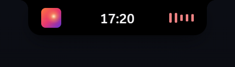
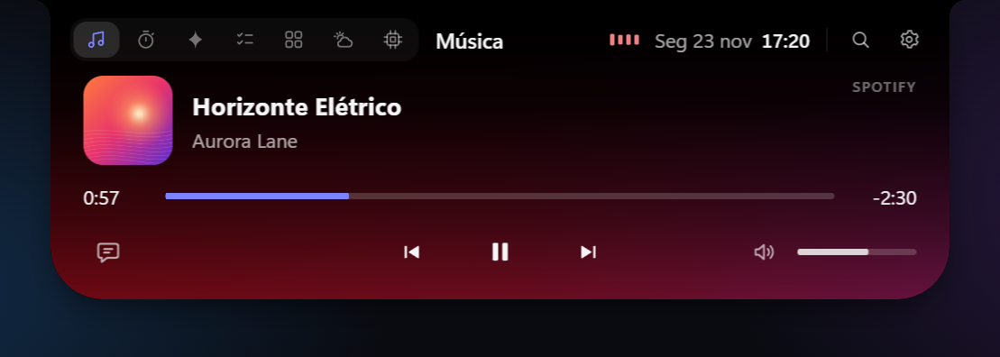
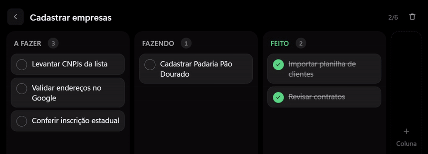
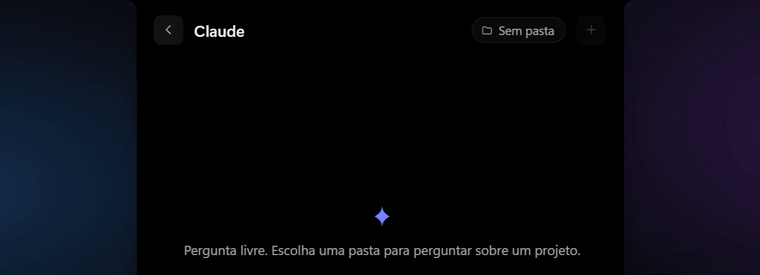
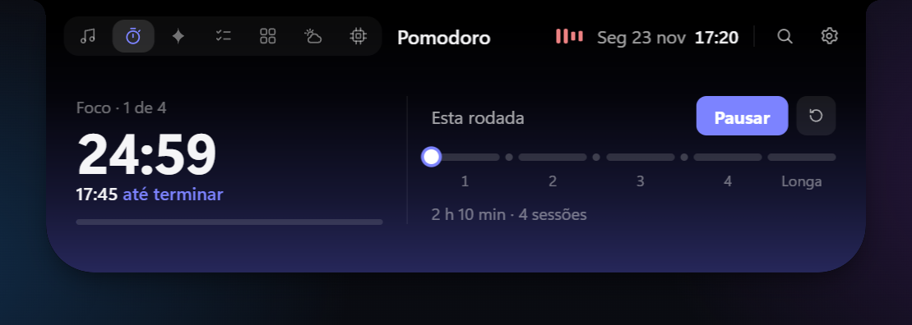
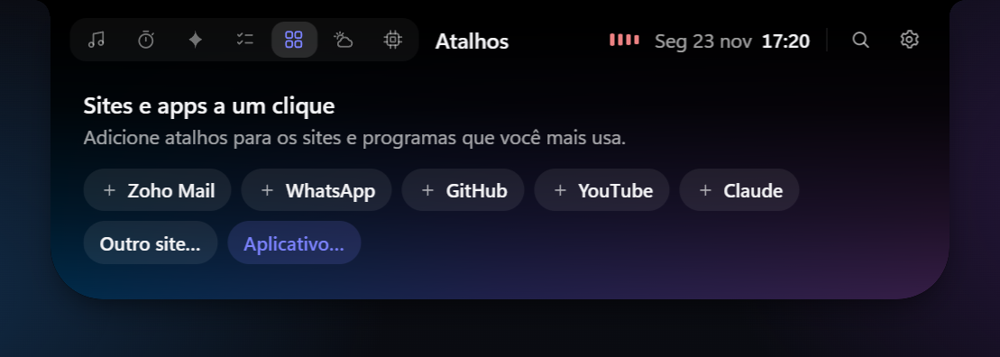
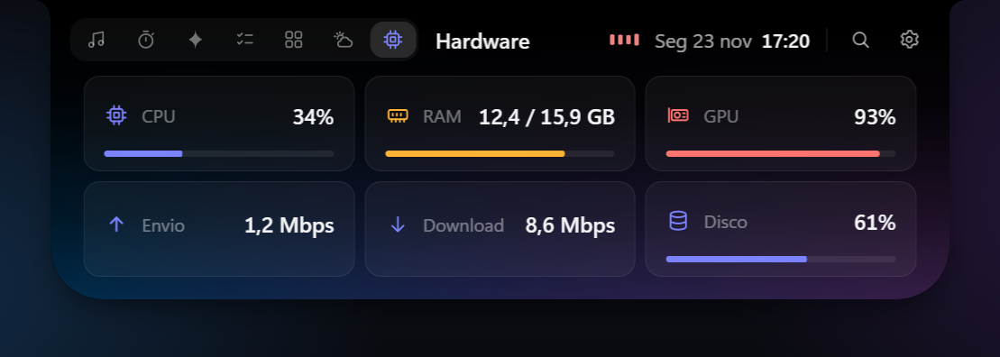
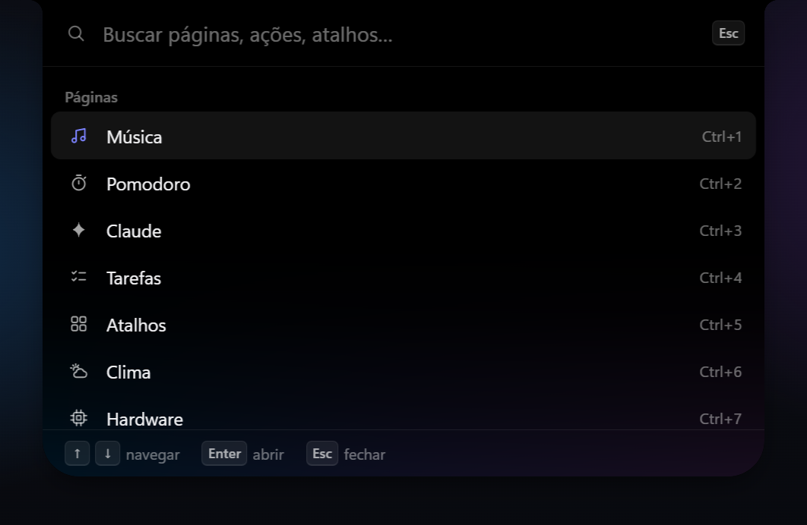
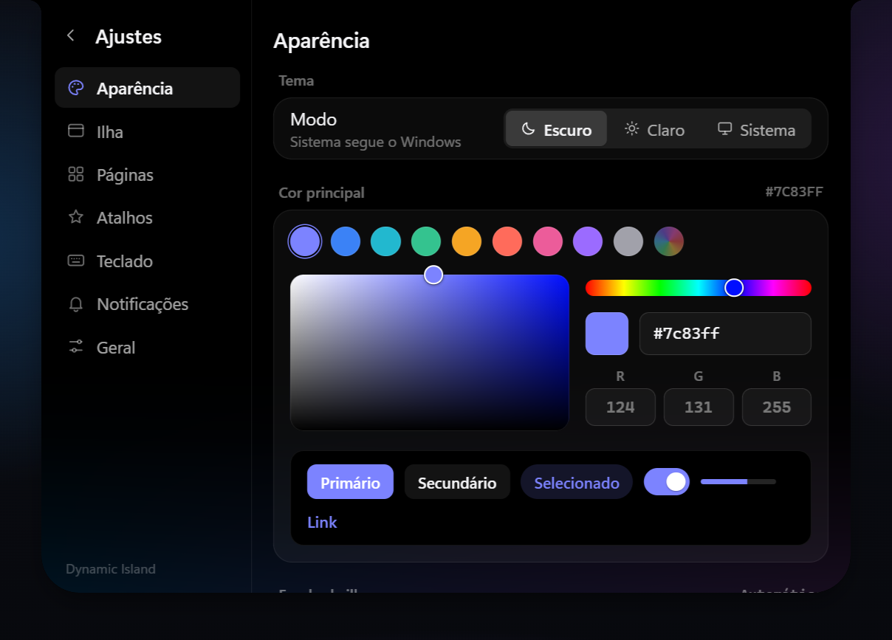
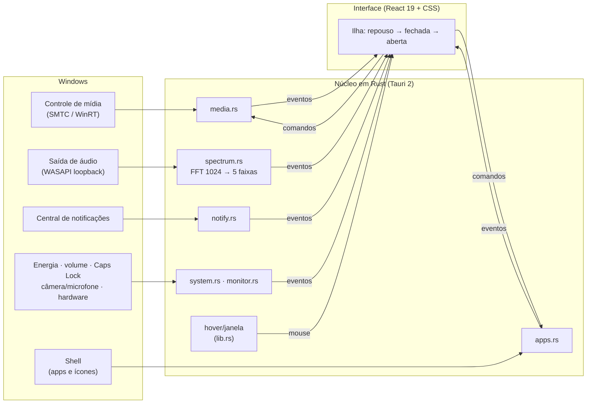

<div align="center">


# Dynamic Island para Windows

**A ilha dinâmica do iPhone, no topo da tela do seu PC: música, foco, tarefas e um assistente, a um olhar de distância.**

[](https://github.com/CaasiDantas/dynamic-island/releases/latest)
[](https://github.com/CaasiDantas/dynamic-island/releases)


[](LICENSE)

[**Baixar para Windows**](https://github.com/CaasiDantas/dynamic-island/releases/latest) · [Recursos](#recursos) · [Como funciona](#como-funciona) · [Desenvolvimento](#desenvolvimento)

<br />


</div>

<br />

## Por quê

O topo da tela é o lugar mais nobre e mais desperdiçado do Windows. A Dynamic Island transforma esse espaço numa cápsula viva: ela fica quase invisível enquanto você trabalha, mostra só o que importa no momento (a música que está tocando, o tempo de foco, um lembrete) e se abre num clique quando você precisa de mais.

Sem conta, sem nuvem, sem anúncios. Roda nativa, a 60 fps, e fica em ~0% de CPU quando parada.

<br />

## Recursos

<table>
<tr>
<td width="50%" valign="top">

### 🎵 Música, como no iPhone
Capa do álbum, barras que **seguem o som de verdade** (análise de frequência do áudio do PC, não uma animação em loop), controles, barra de progresso com seek, **volume do Windows** e **letra sincronizada** no Spotify. Funciona com Spotify, YouTube no navegador e qualquer player que apareça no controle de mídia do Windows.

</td>
<td width="50%" valign="top">


<br /><br />


</td>
</tr>
<tr>
<td width="50%" valign="top">



</td>
<td width="50%" valign="top">

### ✅ Tarefas e pastas com quadro
Lista do dia com lembretes que a ilha avisa na hora certa, calendário e histórico. Para projetos, crie **pastas** (ex.: *Cadastrar empresas*) que abrem um **quadro em colunas**: arraste os cartões de *A fazer* para *Feito*, renomeie e crie colunas do seu jeito.

</td>
</tr>
<tr>
<td width="50%" valign="top">

### ✦ Claude no topo da tela
Pergunte qualquer coisa ou aponte uma pasta de código e pergunte sobre ela. Usa o **Claude Code** instalado no seu PC (sem chave de API), em modo somente leitura, com a resposta chegando em tempo real.

</td>
<td width="50%" valign="top">



</td>
</tr>
<tr>
<td width="50%" valign="top">


</td>
<td width="50%" valign="top">

### 🔔 Avisos que não atrapalham
Notificações do WhatsApp e de outros apps que você escolher, fone conectado, carregador, Caps Lock e volume aparecem como pílulas que crescem da ilha e somem sozinhas. Clique para abrir o app de origem.

</td>
</tr>
</table>

### E mais

| | |
|---|---|
|  | **Pomodoro** com rodadas, pausa longa e a hora em que o foco termina. A ilha fechada vira um cronômetro. |
|  | **Atalhos** de sites e de **aplicativos** (inclusive os da Microsoft Store), com o ícone real de cada um. |
|  | **Hardware** ao vivo: CPU, GPU, RAM, disco e rede. Pontinhos verde/laranja quando a câmera ou o microfone estão em uso. |
|  | **Paleta de comandos** (`Ctrl+K` dentro da ilha ou `Ctrl+Alt+Espaço` de qualquer lugar): páginas, ações, atalhos e controles de música. |
|  | **Ajustes completos:** tema por qualquer cor (tokens OKLCH com contraste WCAG), claro/escuro, formato da ilha, ordem das abas, atalhos de teclado e notificações. |

<br />

## Instalação

1. Baixe o instalador `DynamicIsland_x.y.z_x64-setup.exe` na [última versão](https://github.com/CaasiDantas/dynamic-island/releases/latest).
2. Execute. Ele instala só para o seu usuário (não pede administrador).
3. A ilha aparece no topo da tela e passa a **abrir junto com o Windows**. Dá para desligar em *Ajustes → Geral* ou no ícone da bandeja.

**Atualizações:** quando sai uma versão nova, a ilha avisa. Um clique baixa, instala e reabre, sem precisar entrar aqui de novo.

> [!NOTE]
> O Windows SmartScreen pode avisar na primeira execução porque o instalador ainda não tem certificado de assinatura de código. Clique em *Mais informações → Executar assim mesmo*. As atualizações são assinadas com a chave do projeto e o app recusa qualquer pacote com assinatura diferente.

<br />

## Atalhos de teclado

| Atalho | Ação |
|---|---|
| `Ctrl` `Alt` `Espaço` | Abre a paleta de comandos de qualquer lugar (configurável) |
| `Ctrl` `K` | Paleta de comandos com a ilha aberta |
| `Ctrl` `1`…`9` | Vai direto para uma página |
| `←` `→` / roda do mouse nas abas | Página anterior / próxima |
| `Ctrl` `,` | Ajustes |
| `Esc` | Fecha o painel atual |

<br />

## Como funciona



- **Nativo onde importa.** Cada integração do Windows vive numa thread Rust própria, dona dos seus objetos COM/WinRT, e só avisa a interface quando algo muda. Sem polling no JavaScript.
- **Visualizador de verdade.** O áudio que sai do PC é capturado em loopback, passa por janela de Hann e FFT de 1024 pontos e vira 5 faixas (grave → agudo) com ganho automático. A captura só liga com música tocando e barras na tela.
- **60 fps como requisito.** Animações só de `transform`/`opacity` (no compositor), nada de blur animado, nenhuma chamada ao Rust por quadro. As barras recebem ~30 valores/s e o CSS interpola o resto.
- **Janela que não atrapalha.** Fora da cápsula, o mouse atravessa a janela. A área de clique acompanha o tamanho da ilha, e a ilha em repouso cobre só alguns pixels.

<br />

## Privacidade

Tudo fica no seu PC (`localStorage` do app). Os únicos serviços externos são:

| Serviço | Para quê | O que recebe |
|---|---|---|
| [LRCLIB](https://lrclib.net) | Letras sincronizadas | Título, artista e duração da música |
| [wttr.in](https://wttr.in) | Clima | A cidade (ou a localização aproximada pelo IP) |
| GitHub Releases | Verificar atualização | Uma consulta ao `latest.json` |
| Claude Code (local) | Assistente | Só o que você pergunta, pela sua conta do Claude |

<br />

## Desenvolvimento

**Requisitos:** Windows 10/11, [Node.js 20+](https://nodejs.org), [Rust](https://rustup.rs) (stable) e o [WebView2](https://developer.microsoft.com/microsoft-edge/webview2/) (já vem no Windows 11).

```bash
git clone https://github.com/CaasiDantas/dynamic-island.git
cd dynamic-island
npm install
npm run tauri dev
```

| Comando | O que faz |
|---|---|
| `npm run tauri dev` | App com recarga ao vivo (interface e Rust) |
| `npm run dev` + `?demo=1` | Só a interface no navegador, com dados de demonstração |
| `npm run tauri build` | Gera o instalador NSIS em `src-tauri/target/release/bundle/nsis/` |
| `npm run release` | Build assinado + Release no GitHub com `latest.json` (atualização automática) |

<details>
<summary><b>Estrutura do projeto</b></summary>

```
src/
├─ island/            Cápsula, estados (repouso/fechada/aberta), abas e ajustes
├─ features/
│  ├─ media/          Música, visualizador, volume e letra
│  ├─ todo/           Tarefas, lembretes, calendário e quadros
│  ├─ shortcuts/      Atalhos de sites e aplicativos
│  ├─ claude/         Assistente (Claude Code)
│  ├─ pomodoro/  weather/  monitor/  notify/  pills/  palette/  update/
├─ lib/               Tema (OKLCH), layout, atalhos de teclado
└─ styles/            CSS por área, só com tokens do tema
src-tauri/src/
├─ lib.rs             Janela, hover e área de clique
├─ media.rs           SMTC (WinRT)
├─ spectrum.rs        Loopback WASAPI + FFT
├─ apps.rs            Apps do Menu Iniciar, ícones e abertura
├─ notify.rs          Notificações do Windows
├─ system.rs          Energia, volume, áudio, Caps Lock
├─ monitor.rs         CPU, GPU, RAM, disco, rede, câmera/microfone
├─ claude.rs          Claude Code em modo headless
├─ hotkey.rs  tray.rs
```

</details>

<details>
<summary><b>Publicando uma versão</b></summary>

1. Suba a versão em `package.json`, `src-tauri/tauri.conf.json` e `src-tauri/Cargo.toml`.
2. Escreva as notas em `CHANGELOG.md`, numa seção `## x.y.z`.
3. Rode `npm run release`. O script compila, assina com a chave em `~/.tauri/dynamic-island.key`, cria a Release com o instalador e o `latest.json` e, a partir daí, quem tem o app recebe o aviso.

</details>

<br />

## Licença

[MIT](LICENSE) © Isaac Dantas
