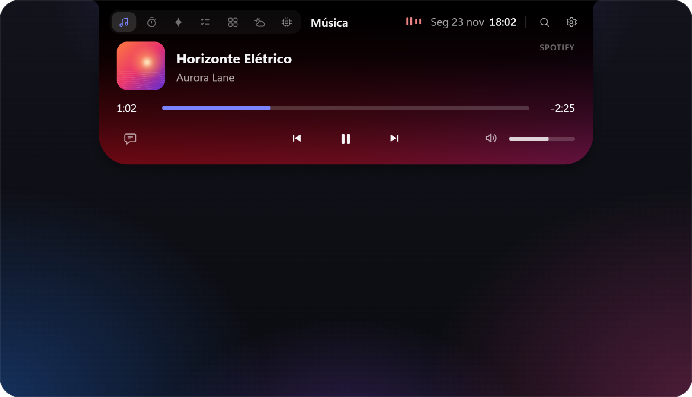
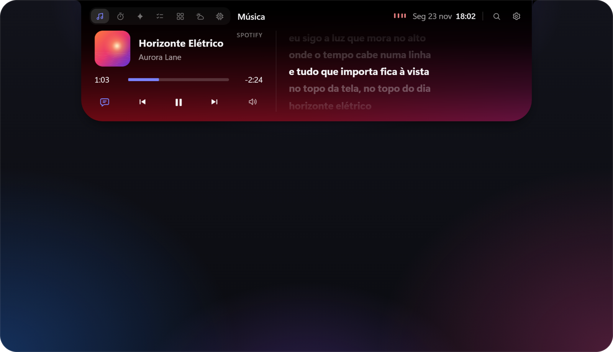
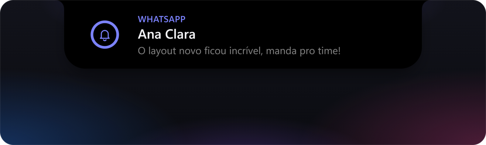
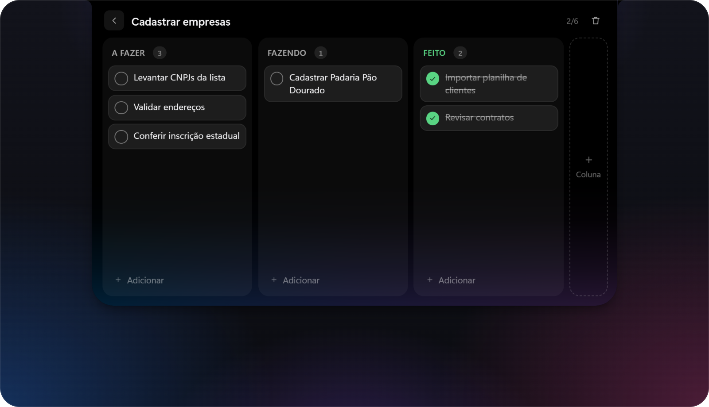
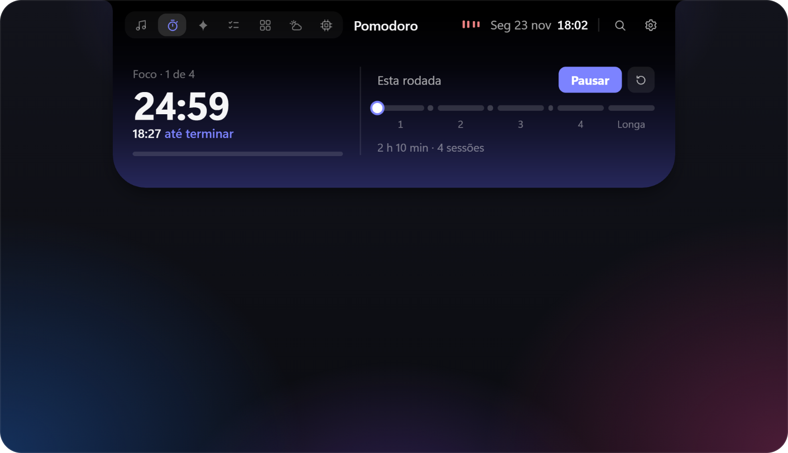
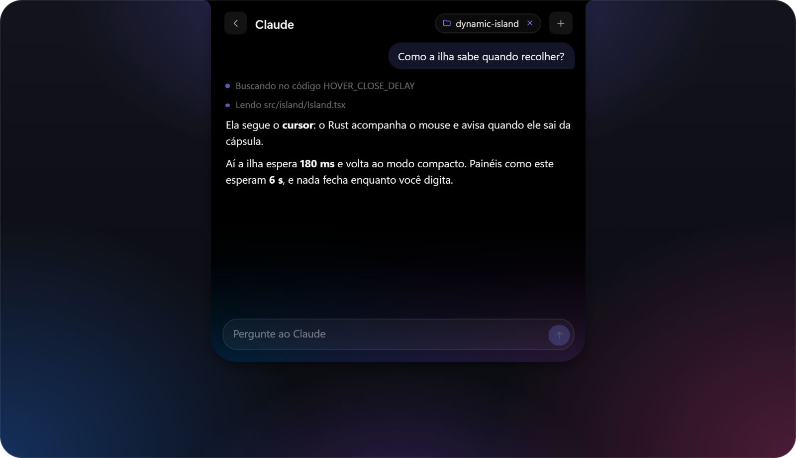
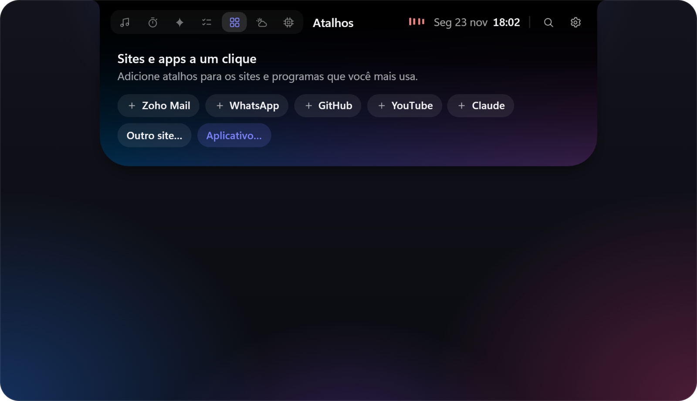
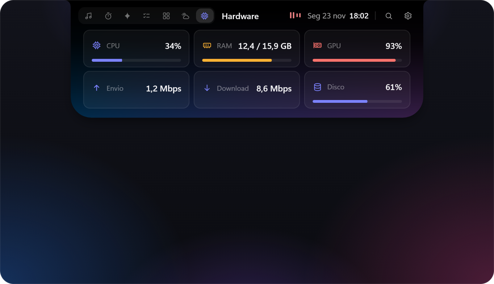
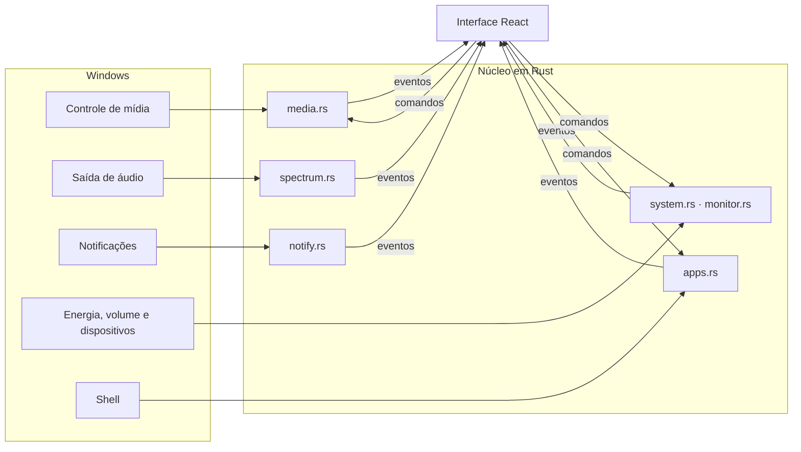

<div align="center">


<br />
<br />

[](https://github.com/CaasiDantas/dynamic-island/releases/latest)
[](https://github.com/CaasiDantas/dynamic-island/releases)
[](#instalação)
[](LICENSE)

**[Baixar para Windows](https://github.com/CaasiDantas/dynamic-island/releases/latest)** &nbsp;·&nbsp;
[Novidades](CHANGELOG.md) &nbsp;·&nbsp;
[Reportar um problema](https://github.com/CaasiDantas/dynamic-island/issues/new/choose)

</div>

<br />

## Visão geral

Dynamic Island para Windows é uma cápsula discreta no centro do topo da tela. Ela fica quase invisível enquanto você trabalha, mostra só o que importa no momento (a música tocando, o tempo de foco, uma notificação) e se abre quando você passa o mouse ou clica.

Tudo roda no seu computador. Não há conta, nuvem, telemetria nem anúncios.

<p align="center">
  
</p>

<br />

## Recursos

<table>
  <tr>
    <td width="50%" valign="top">
      
      <h3>Música</h3>
      Capa, controles, progresso com avanço por clique e volume do Windows. Funciona com Spotify, navegadores e qualquer player que use o controle de mídia do sistema.
    </td>
    <td width="50%" valign="top">
      
      <h3>Letra sincronizada</h3>
      A letra acompanha a música linha a linha, com destaque na frase atual. Clique numa linha para pular até ela.
    </td>
  </tr>
  <tr>
    <td width="50%" valign="top">
      
      <h3>Atividade ao vivo</h3>
      Fechada, a ilha mostra a capa, a hora e um visualizador que reage ao áudio real do PC, calculado por análise de frequência.
    </td>
    <td width="50%" valign="top">
      
      <h3>Avisos</h3>
      Notificações dos apps que você escolher, fone conectado, carregador, volume e Caps Lock aparecem na ilha e somem sozinhos.
    </td>
  </tr>
  <tr>
    <td width="50%" valign="top">
      
      <h3>Tarefas e quadros</h3>
      Lista do dia com lembretes e calendário. Para projetos, crie pastas que abrem um quadro em colunas e arraste os cartões entre elas.
    </td>
    <td width="50%" valign="top">
      
      <h3>Foco</h3>
      Pomodoro com rodadas, pausa longa e a hora prevista de término. Durante o foco, a ilha fechada vira um cronômetro.
    </td>
  </tr>
  <tr>
    <td width="50%" valign="top">
      
      <h3>Assistente</h3>
      Converse com o Claude ou aponte uma pasta de código e pergunte sobre ela. Usa o Claude Code instalado no PC, em modo somente leitura.
    </td>
    <td width="50%" valign="top">
      
      <h3>Atalhos</h3>
      Abra sites e aplicativos, inclusive os da Microsoft Store, com o ícone real de cada um.
    </td>
  </tr>
  <tr>
    <td width="50%" valign="top">
      
      <h3>Hardware</h3>
      CPU, GPU, memória, disco e rede em tempo real, com indicador de câmera e microfone em uso.
    </td>
    <td width="50%" valign="top">
      
      <h3>Personalização</h3>
      Tema claro ou escuro, qualquer cor de destaque com contraste garantido, formato da ilha, ordem das páginas e atalhos de teclado.
    </td>
  </tr>
</table>

<br />

## Instalação

1. Baixe `DynamicIsland_x.y.z_x64-setup.exe` na [versão mais recente](https://github.com/CaasiDantas/dynamic-island/releases/latest).
2. Execute o instalador. A instalação é só para o seu usuário e não pede permissão de administrador.
3. A ilha aparece no topo da tela e passa a iniciar com o Windows. Para desligar, use *Ajustes → Geral* ou o ícone na bandeja.

**Atualizações.** Quando sai uma versão nova, a ilha avisa. Um clique baixa, instala e reabre o app. Os pacotes são assinados, e o app recusa qualquer atualização com assinatura diferente.

| Requisito | |
|---|---|
| Sistema | Windows 10 ou 11, 64 bits |
| Runtime | Microsoft Edge WebView2 (já incluído no Windows 11) |
| Assistente (opcional) | [Claude Code](https://docs.anthropic.com/claude-code) instalado e conectado |

> [!NOTE]
> O instalador ainda não tem certificado de assinatura de código, então o SmartScreen pode exibir um aviso na primeira execução. Escolha *Mais informações → Executar assim mesmo*.

<br />

## Atalhos de teclado

<table>
  <tr>
    <td width="50%" valign="top">

| Atalho | Ação |
|---|---|
| <kbd>Ctrl</kbd> <kbd>Alt</kbd> <kbd>Espaço</kbd> | Paleta de comandos, de qualquer lugar |
| <kbd>Ctrl</kbd> <kbd>K</kbd> | Paleta de comandos com a ilha aberta |
| <kbd>Ctrl</kbd> <kbd>1</kbd> … <kbd>9</kbd> | Ir para uma página |
| <kbd>←</kbd> <kbd>→</kbd> | Página anterior ou seguinte |
| <kbd>Ctrl</kbd> <kbd>,</kbd> | Ajustes |
| <kbd>Esc</kbd> | Fechar o painel atual |

O atalho global pode ser trocado em *Ajustes → Teclado*.

</td>
    <td width="50%" valign="top">
      
    </td>
  </tr>
</table>

<br />

## Arquitetura

O núcleo é escrito em Rust sobre o [Tauri 2](https://tauri.app). Cada integração com o Windows roda numa thread própria e só envia eventos para a interface quando algo muda. A interface é feita em React 19 com CSS puro.



| Área | Como funciona |
|---|---|
| Música | Sessões de mídia do Windows (SMTC) via WinRT |
| Visualizador | Captura do áudio em loopback (WASAPI), FFT de 1024 pontos e 5 faixas de frequência com ganho automático. Só fica ativo com música tocando e a ilha visível. |
| Janela | Janela transparente sempre no topo. Fora da cápsula, os cliques passam para o que está atrás. |
| Desempenho | Animações apenas em `transform` e `opacity`, sem chamadas ao núcleo a cada quadro |
| Atualizações | `tauri-plugin-updater` com pacotes assinados publicados nas Releases |

<br />

## Privacidade

Os dados ficam no armazenamento local do app. Os únicos serviços externos consultados são:

| Serviço | Uso | Dados enviados |
|---|---|---|
| [LRCLIB](https://lrclib.net) | Letras sincronizadas | Título, artista e duração da música |
| [wttr.in](https://wttr.in) | Clima | Cidade configurada ou localização aproximada pelo IP |
| GitHub Releases | Verificação de atualização | Nenhum dado pessoal |
| Claude Code | Assistente | Apenas o que você pergunta, pela sua conta |

<br />

## Desenvolvimento

Requisitos: [Node.js 20+](https://nodejs.org), [Rust](https://rustup.rs) estável e as [dependências do Tauri para Windows](https://tauri.app/start/prerequisites/).

```bash
git clone https://github.com/CaasiDantas/dynamic-island.git
cd dynamic-island
npm install
npm run tauri dev
```

| Comando | Descrição |
|---|---|
| `npm run tauri dev` | App com recarga ao vivo da interface e do núcleo |
| `npm run dev` | Só a interface no navegador; use `?demo=1` para dados de demonstração |
| `npm run tauri build` | Instalador NSIS em `src-tauri/target/release/bundle/nsis/` |
| `npm run release` | Build assinado e publicação da Release com o manifesto de atualização |

<details>
<summary><strong>Estrutura do projeto</strong></summary>

```
src/
├─ island/          Cápsula, estados, páginas e ajustes
├─ features/        Música, tarefas, atalhos, assistente, foco, clima,
│                   hardware, notificações, paleta e atualização
├─ lib/             Tema, layout e teclado
└─ styles/          Estilos por área, baseados em tokens do tema
src-tauri/src/
├─ lib.rs           Janela, hover e área de clique
├─ media.rs         Sessões de mídia (SMTC)
├─ spectrum.rs      Captura de áudio e FFT
├─ apps.rs          Aplicativos do Menu Iniciar e ícones
├─ notify.rs        Notificações do Windows
├─ system.rs        Energia, volume e Caps Lock
├─ monitor.rs       Hardware, câmera e microfone
├─ claude.rs        Integração com o Claude Code
└─ hotkey.rs, tray.rs
```

</details>

<details>
<summary><strong>Publicando uma versão</strong></summary>

1. Atualize a versão em `package.json`, `src-tauri/tauri.conf.json` e `src-tauri/Cargo.toml`.
2. Descreva as mudanças em `CHANGELOG.md`, numa seção `## x.y.z`.
3. Execute `npm run release`. O script compila, assina, cria a Release e publica o `latest.json` que o app consulta.

</details>

<br />

## Contribuindo

Relatos de problemas e sugestões são bem-vindos em [Issues](https://github.com/CaasiDantas/dynamic-island/issues). Antes de abrir um pull request, leia o [guia de contribuição](CONTRIBUTING.md). Para falhas de segurança, siga a [política de segurança](SECURITY.md).

## Licença

Distribuído sob a [licença MIT](LICENSE).

<sub>Dynamic Island é um nome usado pela Apple Inc. Este projeto é independente e não tem relação com a Apple.</sub>
