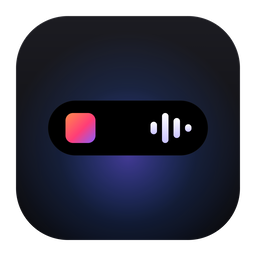
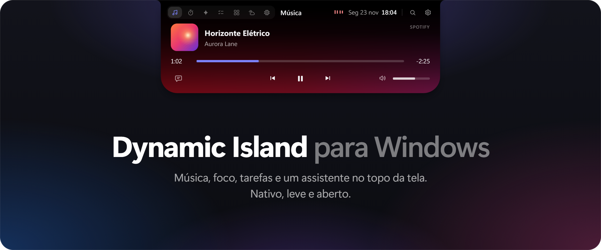
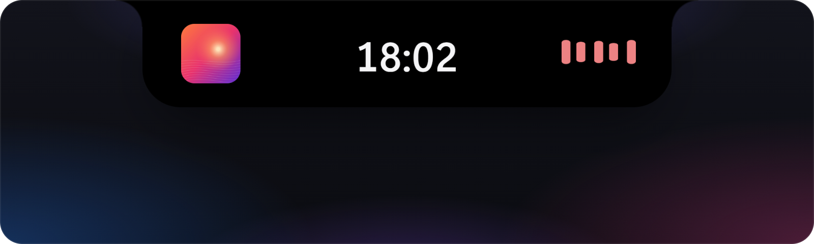
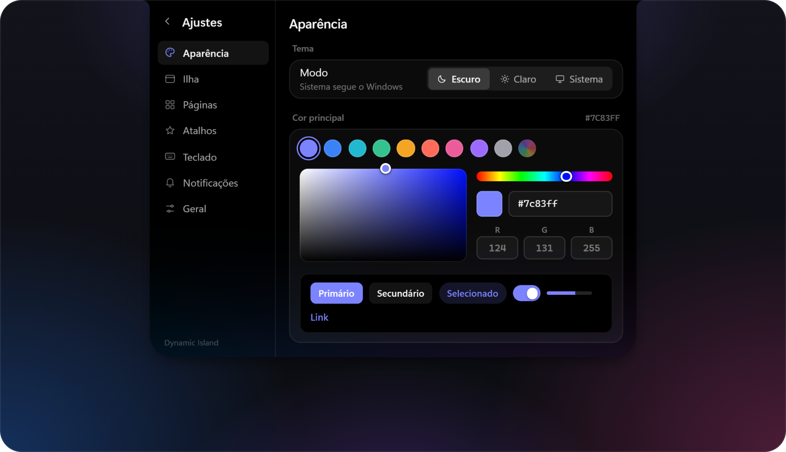
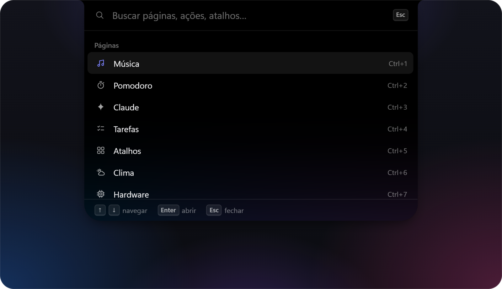
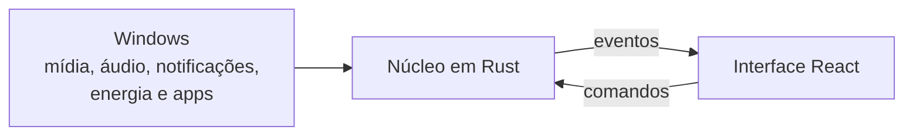

<div align="center">

<a href="https://github.com/CaasiDantas/dynamic-island/releases/latest">
  
</a>

<h1>Dynamic Island para Windows</h1>

<a href="https://github.com/CaasiDantas/dynamic-island/releases/latest">Baixar</a> |
<a href="CHANGELOG.md">Novidades</a> |
<a href="#-como-funciona">Como funciona</a> |
<a href="CONTRIBUTING.md">Contribuir</a> |
<a href="https://github.com/CaasiDantas/dynamic-island/issues/new/choose">Reportar um problema</a>

<br />
<br />

**Música, foco, tarefas e avisos numa cápsula discreta no topo da tela.**

<br />

[](https://github.com/CaasiDantas/dynamic-island/releases/latest)
[](https://github.com/CaasiDantas/dynamic-island/releases)
[](#-experimente)
[](LICENSE)

</div>

<br />

<a href="https://github.com/CaasiDantas/dynamic-island/releases/latest">
  
</a>

## O que é o Dynamic Island?

**Dynamic Island para Windows** é uma cápsula no centro do topo da tela. Ela fica quase invisível enquanto você trabalha, mostra só o que importa no momento e se abre quando você passa o mouse ou clica.

Num só lugar você tem **música com letra sincronizada**, **visualizador de áudio**, **Pomodoro**, **tarefas em quadros**, **avisos do sistema**, **atalhos** e **monitor de hardware**, com tema e cores do seu jeito.

Tudo roda no seu computador: **sem conta, sem nuvem, sem telemetria e sem anúncios**.

## ⚡ Experimente

1. Baixe o `DynamicIsland_x.y.z_x64-setup.exe` na [versão mais recente](https://github.com/CaasiDantas/dynamic-island/releases/latest).
2. Execute o instalador. Ele instala só para o seu usuário, sem pedir administrador.
3. Pronto: a ilha aparece no topo da tela e passa a abrir junto com o Windows.

Funciona no **Windows 10 e 11 (64 bits)**. As atualizações chegam pela própria ilha: um clique baixa, instala e reabre o app, sempre com pacote assinado.

> [!NOTE]
> O instalador ainda não tem certificado de assinatura de código, então o SmartScreen pode avisar na primeira execução. Escolha *Mais informações → Executar assim mesmo*.

<p align="center">
  
</p>

## Recursos principais

- **Música** com capa, controles, progresso clicável e volume do Windows. Funciona com Spotify, navegadores e qualquer player que use o controle de mídia do sistema.
- **Letra sincronizada** linha a linha, com destaque na frase atual. Clique numa linha para pular até ela.
- **Atividade ao vivo** com a ilha fechada: capa, hora e um visualizador que reage ao áudio real do PC.
- **Avisos** de notificações dos apps que você escolher, fone conectado, carregador, volume e Caps Lock.
- **Tarefas e quadros**: lista do dia com lembretes e calendário, e pastas que viram quadros em colunas com cartões arrastáveis.
- **Foco** com Pomodoro, rodadas, pausa longa e hora prevista de término. Durante o foco, a ilha fechada vira cronômetro.
- **Atalhos** para sites e aplicativos, inclusive os da Microsoft Store, com o ícone real de cada um.
- **Hardware** em tempo real (CPU, GPU, memória, disco e rede) e indicador de câmera e microfone em uso.
- **Personalização** de tema claro ou escuro, cor de destaque com contraste garantido, formato da ilha e ordem das páginas.

<table>
  <tr>
    <td width="50%"></td>
    <td width="50%"></td>
  </tr>
  <tr>
    <td width="50%"></td>
    <td width="50%"></td>
  </tr>
  <tr>
    <td width="50%"></td>
    <td width="50%"></td>
  </tr>
  <tr>
    <td width="50%"></td>
    <td width="50%"></td>
  </tr>
</table>

## ⌨️ Atalhos de teclado



- <kbd>Ctrl</kbd> <kbd>Alt</kbd> <kbd>Espaço</kbd> abre a paleta de comandos de qualquer lugar
- <kbd>Ctrl</kbd> <kbd>K</kbd> abre a paleta com a ilha aberta
- <kbd>Ctrl</kbd> <kbd>1</kbd> … <kbd>9</kbd> vai direto para uma página
- <kbd>←</kbd> <kbd>→</kbd> passa para a página anterior ou seguinte
- <kbd>Ctrl</kbd> <kbd>,</kbd> abre os ajustes
- <kbd>Esc</kbd> fecha o painel atual

O atalho global pode ser trocado em *Ajustes → Teclado*.

<br clear="right" />

## 🧩 Como funciona

O núcleo é escrito em **Rust** sobre o [Tauri 2](https://tauri.app) e a interface em **React 19** com CSS puro. Cada integração com o Windows roda numa thread própria e só avisa a interface quando algo muda.



- **Música** vem das sessões de mídia do Windows (SMTC).
- **Visualizador** captura o áudio em loopback (WASAPI) e faz uma FFT em 5 faixas. Só fica ativo com música tocando e a ilha visível.
- **Janela** transparente e sempre no topo. Fora da cápsula, os cliques passam para o que está atrás.
- **Desempenho**: animações só em `transform` e `opacity`, sem chamadas ao núcleo a cada quadro.

## 🔒 Privacidade

Seus dados ficam no armazenamento local do app. Os únicos serviços externos consultados são:

- [LRCLIB](https://lrclib.net), para letras, com título, artista e duração da música.
- [wttr.in](https://wttr.in), para o clima, com a cidade configurada ou a localização aproximada pelo IP.
- **GitHub Releases**, para checar atualizações, sem nenhum dado pessoal.

## 🛠️ Desenvolvimento

Você vai precisar de [Node.js 20+](https://nodejs.org), [Rust](https://rustup.rs) estável e das [dependências do Tauri para Windows](https://tauri.app/start/prerequisites/).

```bash
git clone https://github.com/CaasiDantas/dynamic-island.git
cd dynamic-island
npm install
npm run tauri dev
```

- `npm run tauri dev` abre o app com recarga ao vivo da interface e do núcleo.
- `npm run dev` abre só a interface no navegador. Use `?demo=1` para dados de demonstração.
- `npm run tauri build` gera o instalador em `src-tauri/target/release/bundle/nsis/`.
- `npm run release` compila, assina e publica a Release com o manifesto de atualização.

<details>
<summary><strong>Estrutura do projeto</strong></summary>

```
src/
├─ island/          Cápsula, estados, páginas e ajustes
├─ features/        Música, tarefas, atalhos, foco, clima, hardware,
│                   notificações, paleta e atualização
├─ lib/             Tema, layout e teclado
└─ styles/          Estilos por área, baseados em tokens do tema
src-tauri/src/
├─ lib.rs           Janela, hover e área de clique
├─ media.rs         Sessões de mídia (SMTC)
├─ spectrum.rs      Captura de áudio e FFT
├─ apps.rs          Aplicativos do Menu Iniciar e ícones
├─ notify.rs        Notificações do Windows
├─ system.rs        Energia, volume e Caps Lock
├─ monitor.rs       Hardware, câmera e microfone
└─ hotkey.rs, tray.rs
```

</details>

<details>
<summary><strong>Publicando uma versão</strong></summary>

1. Atualize a versão em `package.json`, `src-tauri/tauri.conf.json` e `src-tauri/Cargo.toml`.
2. Descreva as mudanças em `CHANGELOG.md`, numa seção `## x.y.z`.
3. Execute `npm run release`. O script compila, assina, cria a Release e publica o `latest.json` que o app consulta.

</details>

## Contribuindo

Problemas e sugestões são bem-vindos nas [Issues](https://github.com/CaasiDantas/dynamic-island/issues). Antes de abrir um pull request, leia o [guia de contribuição](CONTRIBUTING.md). Para falhas de segurança, siga a [política de segurança](SECURITY.md).

## Licença

Licenciado sob a [licença MIT](LICENSE), Copyright © 2026 Isaac Dantas.

<sub>Dynamic Island é um nome usado pela Apple Inc. Este projeto é independente e não tem relação com a Apple.</sub>
